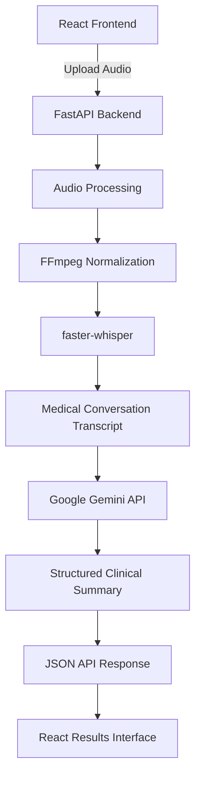
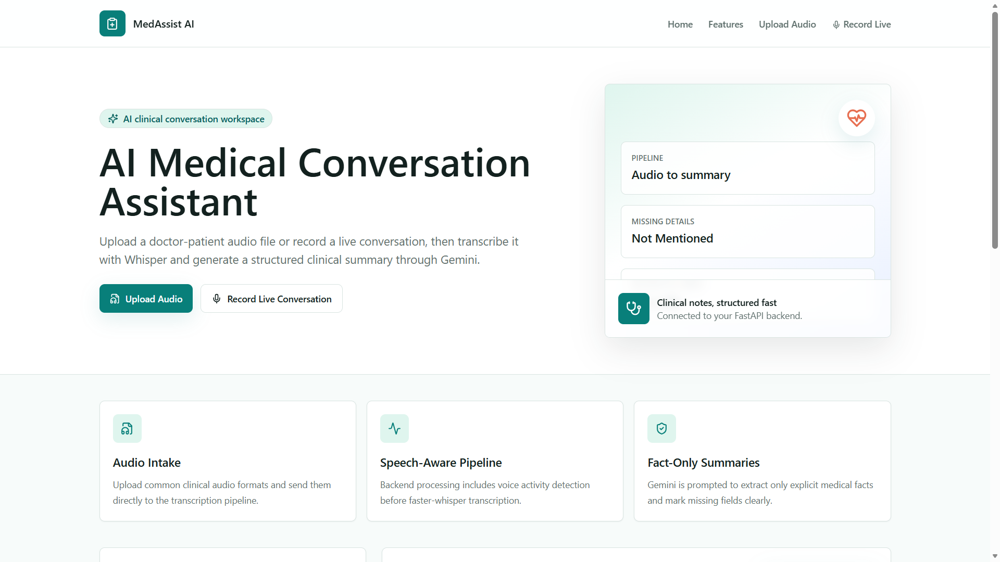
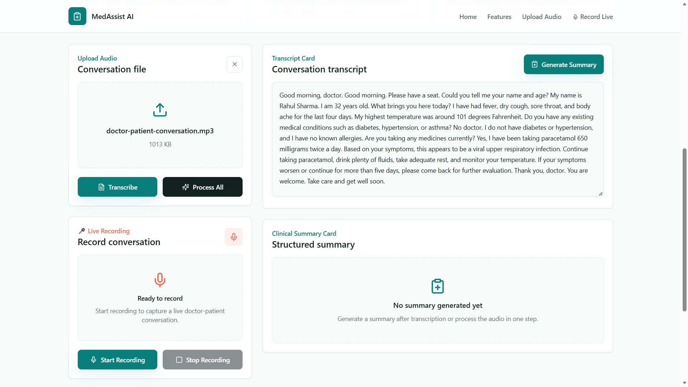
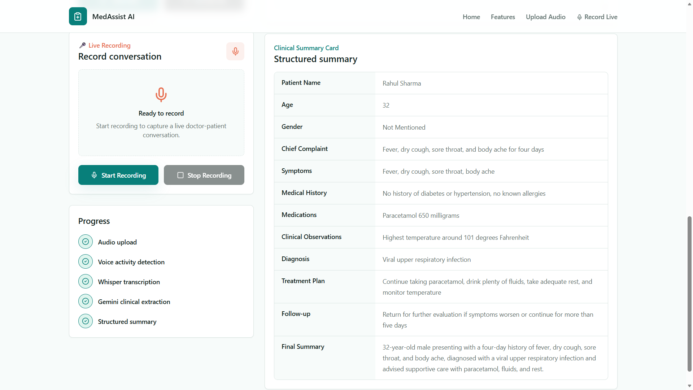

# 🩺 AI Medical Conversation Assistant

**Transform doctor–patient conversations into structured clinical documentation using AI.**

AI Medical Conversation Assistant is a full-stack application that converts medical conversation audio into readable transcripts and structured clinical summaries using **faster-whisper, Google Gemini, FastAPI, and React**.

The application combines speech-to-text transcription with AI-powered clinical fact extraction to help streamline medical documentation workflows. It is designed to extract only information explicitly mentioned in the conversation, returning **`Not Mentioned`** for unavailable details instead of inventing clinical facts.

> ⚠️ **Important:** This project is intended for clinical documentation assistance and educational use. It is not a diagnostic system and must not replace professional medical judgment. All generated summaries should be reviewed by a qualified healthcare professional.

---

## ✨ Key Features

- 🎙️ **AI-Powered Transcription:** Convert medical audio recordings into readable text using faster-whisper.
- 🔊 **Audio Preprocessing:** Normalize audio using FFmpeg before transcription.
- 🧠 **Structured Clinical Extraction:** Use Google Gemini to organize conversation details into a predefined clinical schema.
- 📋 **Clinical Summary Table:** Display patient details, symptoms, medical history, medications, observations, diagnosis, treatment plan, and follow-up information.
- 🎯 **Fact-Grounded Summaries:** Instruct the model to use only explicitly mentioned information and return `Not Mentioned` when details are unavailable.
- ⚡ **Full-Stack Architecture:** Connect a React frontend to a FastAPI backend using REST APIs.
- 📊 **Processing Feedback:** Display loading states, progress indicators, toast notifications, and backend errors.
- 🔌 **Modular Backend:** Separate API routes, data schemas, transcription logic, AI extraction, and audio utilities.
- 📖 **Interactive API Documentation:** Explore and test endpoints through FastAPI's Swagger UI.

## 🖥️ Application Workflow

1. Upload a medical conversation audio file through the React interface.
2. The frontend sends the audio to the FastAPI backend using Axios and multipart form data.
3. FFmpeg preprocesses the audio into a suitable format.
4. faster-whisper transcribes the speech with voice activity detection enabled.
5. Google Gemini extracts structured clinical information from the transcript.
6. The backend returns the transcript and structured summary as JSON.
7. The frontend displays the results for review.

---

## 🏗️ Architecture



### Component Responsibilities

| Component      | Responsibility                          |
| -------------- | --------------------------------------- |
| React + Vite   | User interface and application workflow |
| Tailwind CSS   | Responsive interface styling            |
| Axios          | HTTP requests and file uploads          |
| FastAPI        | Backend routes and request handling     |
| FFmpeg         | Audio preprocessing and normalization   |
| faster-whisper | Speech-to-text transcription            |
| Google Gemini  | Structured clinical fact extraction     |
| Pydantic       | Request and response schema validation  |

---

## 🛠️ Tech Stack

**Frontend**

- React
- Vite
- Tailwind CSS
- Axios
- JavaScript

**Backend**

- Python 3.10+
- FastAPI
- Uvicorn
- Pydantic

**AI & Audio Processing**

- faster-whisper
- FFmpeg
- Google Gemini API

**Development Tools**

- Git and GitHub
- npm
- Python virtual environments
- REST APIs
- Swagger / OpenAPI

---

## 📂 Project Structure

```text
AI-Medical-Conversation-Assistant/
├── backend/
│   ├── app.py
│   ├── __init__.py
│   ├── .env.example
│   ├── requirements.txt
│   ├── models/
│   │   ├── __init__.py
│   │   └── schemas.py
│   ├── routers/
│   │   ├── __init__.py
│   │   └── audio.py
│   ├── services/
│   │   ├── gemini_service.py
│   │   └── whisper_service.py
│   └── utils/
│       ├── __init__.py
│       ├── audio.py
│       ├── exceptions.py
│       └── logging.py
├── frontend/
│   ├── index.html
│   ├── package.json
│   ├── package-lock.json
│   ├── .env.example
│   ├── src/
│   │   ├── App.jsx
│   │   ├── main.jsx
│   │   ├── components/
│   │   ├── constants/
│   │   ├── hooks/
│   │   ├── services/
│   │   ├── styles/
│   │   └── utils/
│   ├── vite.config.js
│   └── tailwind.config.js
├── .env.example
├── .gitignore
├── demo_script.md
├── package.json
├── requirements.txt
└── README.md
```

---

## ⚙️ Prerequisites

Ensure the following tools are installed:

- Python 3.10 or newer
- Node.js 20 or newer
- npm
- FFmpeg installed and available on your system `PATH`
- Google Gemini API key

**Get a Gemini API key:** [Google AI Studio](https://aistudio.google.com/apikey)

## 🚀 Getting Started

### 1. Clone the Repository

```bash
git clone https://github.com/YOUR_USERNAME/YOUR_REPOSITORY.git
cd YOUR_REPOSITORY
```

Replace the repository URL with your actual GitHub repository URL.

### 2. Configure the Backend

Create and activate a Python virtual environment.

**Windows**

```powershell
python -m venv .venv
.venv\Scripts\activate
python -m pip install --upgrade pip
python -m pip install -r requirements.txt
```

**macOS / Linux**

```bash
python3 -m venv .venv
source .venv/bin/activate
python -m pip install --upgrade pip
python -m pip install -r requirements.txt
```

Create the backend environment configuration from the project root:

**Windows**

```powershell
copy .env.example .env
```

**macOS / Linux**

```bash
cp .env.example .env
```

Add your configuration to the root `.env` file:

```dotenv
GEMINI_API_KEY=your_gemini_api_key_here
GEMINI_MODEL=gemini-2.0-flash
```

Use a Gemini model currently supported by your Google AI Studio project. Never commit real API keys to GitHub.

### 3. Configure the Frontend

Open a second terminal:

```bash
cd frontend
npm install
```

Create the frontend environment file.

**Windows**

```powershell
copy .env.example .env
```

**macOS / Linux**

```bash
cp .env.example .env
```

Set the backend URL in `frontend/.env`:

```dotenv
VITE_API_BASE_URL=http://localhost:8000
```

### 4. Install FFmpeg

FFmpeg must be installed separately and accessible through your system's `PATH`.

**Windows:** Install FFmpeg and add its `bin` directory to `PATH`.

**macOS:**

```bash
brew install ffmpeg
```

**Ubuntu / Debian:**

```bash
sudo apt-get update
sudo apt-get install ffmpeg
```

Verify the installation:

```bash
ffmpeg -version
```

### 5. Run the Backend

From the project root, with the virtual environment activated:

```bash
python -m uvicorn backend.app:app --host 0.0.0.0 --port 8000 --reload
```

### 6. Run the Frontend

In another terminal:

```bash
cd frontend
npm run dev
```

Open the application in your browser:

**Frontend:** [http://localhost:5173](http://localhost:5173)

**Backend health check:** [http://localhost:8000/health](http://localhost:8000/health)

**Interactive API documentation:** [http://localhost:8000/docs](http://localhost:8000/docs)

---
## 🖼️ Screenshots

### 🏠 Home Page



### 🎙️ Transcript and Processing



### 📋 Clinical Summary Card



*The application transcribes medical conversations and generates structured clinical summaries using AI.*

**▶ [Watch the Full Demo](https://drive.google.com/file/d/1ya8WEfmDLCifLorH-wVY_xJn8MHakghI/view?usp=sharing)**

---


## 🔌 API Documentation

Base URL:

```text
http://localhost:8000
```

### 1. Health Check

`GET /health`

Checks whether the backend is running.

Example response:

```json
{
  "status": "ok"
}
```

### 2. Transcribe Audio

`POST /transcribe`

Converts an uploaded audio file into text.

**Request**

- Content type: `multipart/form-data`
- Field: `file`

Example:

```bash
curl -X POST "http://localhost:8000/transcribe" \
  -F "file=@conversation.wav"
```

Example response:

```json
{
  "transcript": "Patient reports fever and cough for three days."
}
```

### 3. Generate a Clinical Summary

`POST /generate-summary`

Extracts structured clinical information from an existing transcript.

**Request body**

```json
{
  "transcript": "Patient reports fever and cough for three days."
}
```

Example:

```bash
curl -X POST "http://localhost:8000/generate-summary" \
  -H "Content-Type: application/json" \
  -d "{\"transcript\":\"Patient reports fever and cough for three days.\"}"
```

Example response:

```json
{
  "summary": {
    "patient_name": "Not Mentioned",
    "age": "Not Mentioned",
    "gender": "Not Mentioned",
    "chief_complaint": "Fever and cough",
    "symptoms": "Fever and cough for three days",
    "medical_history": "Not Mentioned",
    "medications": "Not Mentioned",
    "clinical_observations": "Not Mentioned",
    "diagnosis": "Not Mentioned",
    "treatment_plan": "Not Mentioned",
    "follow_up": "Not Mentioned",
    "final_summary": "Patient reports fever and cough for three days."
  }
}
```

### 4. Process Audio End-to-End

`POST /process-audio`

Runs the complete audio-to-documentation pipeline.

**Request**

- Content type: `multipart/form-data`
- Field: `file`

Example:

```bash
curl -X POST "http://localhost:8000/process-audio" \
  -F "file=@conversation.wav"
```

The response contains both the transcript and the structured clinical summary:

```json
{
  "transcript": "Patient reports fever and cough for three days.",
  "summary": {
    "patient_name": "Not Mentioned",
    "age": "Not Mentioned",
    "gender": "Not Mentioned",
    "chief_complaint": "Fever and cough",
    "symptoms": "Fever and cough for three days",
    "medical_history": "Not Mentioned",
    "medications": "Not Mentioned",
    "clinical_observations": "Not Mentioned",
    "diagnosis": "Not Mentioned",
    "treatment_plan": "Not Mentioned",
    "follow_up": "Not Mentioned",
    "final_summary": "Patient reports fever and cough for three days."
  }
}
```

*Note: Example responses illustrate the expected schema. Actual output depends on the supplied audio or transcript.*

---

## 🛡️ Error Handling

The backend returns descriptive error responses when processing fails.

| HTTP Status | Meaning                                        |
| ----------- | ---------------------------------------------- |
| `400`       | Invalid or empty audio file                    |
| `413`       | Audio file exceeds the configured upload limit |
| `415`       | Unsupported audio content type                 |
| `422`       | Empty transcript or no speech detected         |
| `500`       | Backend configuration or internal error        |
| `502`       | Gemini API failure or invalid AI response      |

Example:

```json
{
  "detail": "Error message"
}
```

The frontend displays relevant errors through toast notifications and application status messages.

*The exact status code and error message depend on the backend's configured exception handlers.*

---

## 🧠 Clinical Fact Extraction

A key design principle is to distinguish information explicitly stated in the conversation from information that is missing.

For example, consider this transcript:

> Patient reports fever and cough for three days.

The generated summary can identify the chief complaint and symptom duration. However, the patient's name, age, gender, medical history, medications, and diagnosis should remain `Not Mentioned` unless those facts are explicitly stated.

This approach aims to reduce unsupported information in generated clinical documentation. It does not guarantee perfect transcription or eliminate AI errors, so clinical review remains necessary.

---

## 🔒 Security and Privacy Considerations

Medical conversations may contain sensitive personal and health information.

- Keep Gemini API keys in backend environment variables.
- Never expose secret keys through frontend environment variables or client-side code.
- Do not upload real patient recordings to public repositories or use them in public demos without appropriate authorization.
- Use synthetic or properly de-identified recordings for demonstrations and testing.
- Apply suitable access controls, encryption, retention policies, and audit logging before handling real patient data.
- Review the privacy and data-processing terms of any external AI service before sending it medical information.
- Avoid claiming regulatory compliance unless it has been independently verified.

**This project should not be considered production-ready for real patient data without a dedicated security, privacy, and clinical validation review.**

---


## 🗺️ Future Enhancements

- [ ] Doctor and patient speaker diarization
- [ ] Browser-based live audio recording
- [ ] Export summaries to PDF and DOCX
- [ ] Patient visit history and searchable records
- [ ] Authentication and role-based access control
- [ ] Encrypted storage and configurable data retention
- [ ] Automated backend and frontend tests
- [ ] Docker and Docker Compose support
- [ ] Cloud deployment configuration
- [ ] Confidence indicators and human review workflows
- [ ] EHR-compatible export formats

---

## 🤝 Contributing

Contributions, bug reports, and feature suggestions are welcome.

1. Fork the repository.
2. Create a feature branch.
3. Commit your changes.
4. Open a pull request describing the changes.

For major changes, consider opening an issue first to discuss the proposed implementation.

## 📄 License

This project is licensed under the MIT License. See the [`LICENSE`](LICENSE) file for details.

If the license file has not yet been added to the repository, create it before publishing this license claim.

---

**Built with React, FastAPI, faster-whisper, and Google Gemini.**
